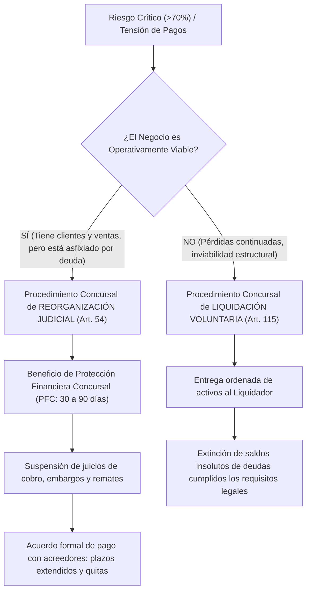

# Marco Jurídico, Avisos Legales y Regulación Concursal (República de Chile)

**Sistema:** SmartFinanzas — Plataforma Transaccional y Analítica Predictiva de Solvencia  
**Marco Legal Principal:** Ley 20.720 (modernizada por Ley 21.563 de 2023), Código de Comercio, Código del Trabajo, Código Tributario y Leyes 19.628 / 21.719  
**Objetivo del Documento:** Estudio exhaustivo de los avisos legales, deberes fiduciarios, responsabilidades de administración y herramientas concursales aplicables a cada módulo y estado de riesgo en la plataforma.

---

## 1. Introducción y Enfoque de Gobernanza

La gestión financiera de las Pequeñas, Medianas y Grandes Empresas en Chile no es solo una disciplina técnica u operativa, sino una actividad sujeta a un estricto **marco de responsabilidad civil, comercial, societaria y penal**.

El ordenamiento jurídico chileno exige a administradores, directores, gerentes y contadores actuar con el estándar de un **ordenado comerciante y leal administrador** (Código de Comercio Art. 41 y Ley 18.046 de Sociedades Anónimas Art. 41). Cuando una empresa entra en dificultades de caja o proyecta insolvencia, las decisiones de pago, retiros de socios, contratación de deuda o reprogramación de pasivos adquieren relevancia jurídica directa ante acreedores, trabajadores, el Servicio de Impuestos Internos (SII) y los tribunales de justicia.

**SmartFinanzas** incorpora cláusulas de certificación, avisos de deslinde fiduciario y protocolos preventivos alineados con el derecho concursal chileno para resguardar la legalidad de los actos mercantiles y guiar a la gerencia hacia decisiones oportunas.

---

## 2. Aviso Legal General de la Plataforma (Disclaimer Fiduciario)

> ### [CLÁUSULA MAESTRA DE DESLINDE DE RESPONSABILIDAD]
> **Naturaleza del Software:** SmartFinanzas es un entorno de software bajo modalidad SaaS que procesa estados contables e información de caja diaria mediante modelos algorítmicos cuantitativos y de Machine Learning (Random Forest) para generar diagnósticos y proyecciones de riesgo a 90 días.
> 
> **Deslinde de Dictamen Pericial o Auditoría Externa:** Los cálculos, scores continuos, semáforos y planes de acción preventivos generados por la plataforma constituyen **herramientas de gestión y apoyo a la toma de decisiones gerenciales de carácter orientativo**. En ningún caso sustituyen:
> 1. Una auditoría de estados financieros independiente bajo Normas Internacionales de Auditoría (NIA / ISA).
> 2. Un informe pericial contable para fines probatorios judiciales.
> 3. La asesoría legal especializada requerida para la presentación formal de solicitudes de reorganización o liquidación concursal ante los tribunales competentes.
> 
> **Decisiones Empresariales:** La dirección superior de la empresa usuaria es la única responsable de los acuerdos de crédito, contratos de reprogramación, ajustes de inventario y compromisos comerciales adoptados.

---

## 3. Avisos Legales Específicos por Módulo Operativo

### A. Módulo ETL: Carga de Balances e Ingesta de Datos IFRS

* **Normativa Base:** Código de Comercio (Artículos 25 al 44) y Normas Internacionales de Información Financiera (NIIF / IFRS adoptadas por la Comisión para el Mercado Financiero - CMF).
* **Certificación Requerida:** Marcado obligatorio de la casilla de verificación:
  > *"Certifico la exactitud contable del balance y acepto los Términos de Ingesta, Veracidad y Validación IFRS."*

#### Texto Legal del Aviso:
1. **Verdad Material y Fe Pública Contable:** El usuario declara bajo fe y juramento administrativo que el archivo contable subido refleja fidedignamente los saldos asentados en los libros obligatorios de la empresa (Diario, Mayor y Balance) y que no contiene omisiones deliberadas de pasivos exigibles ni sobrevaloración de activos circulantes.
2. **Deslinde de Auditoría Física de Inventarios y Cartera:** El motor ETL de SmartFinanzas realiza validaciones sintácticas, de tipos de datos y de la ecuación patrimonial ($|\text{Activo} - (\text{Pasivo} + \text{Patrimonio})| / \text{Activo} \le 5\%$), pero **no efectúa verificación sustantiva de la cobrabilidad real de las facturas ni constatación física en bodegas**.
3. **Efectos Legales del Descuadre:** La presencia de un desbalance patrimonial superior al umbral admisible inhabilita la validez probabilística de la predicción hasta que el contador corrija el asiento contable.

---

### B. Módulo Transaccional: Arqueo Físico, Rendición de Fondos y Cierre Diario de Caja

* **Normativa Base:** Código de Comercio (Artículos 25-44), Código del Trabajo (Artículos 10 N° 7 y 58), Código Tributario (Artículo 33), Normas Internacionales de Auditoría (NIA 240) y Marco COSO de Control Interno.
* **Certificación Requerida:** Marcado obligatorio de la casilla de verificación:
  > *"Certifico bajo fe de arqueo la exactitud del conteo físico y acepto los Términos Legales de Rendición de Fondos, Arqueo Físico y Cierre Contable."*

#### Texto Legal del Aviso:
1. **Fe de Arqueo y Exactitud Probatoria (Código de Comercio Art. 25-44):** El monto registrado en el campo *"Total Efectivo Físico Contado"* representa el inventario estricto de dinero existente en la gaveta al momento del corte.
2. **Deber de Custodia y Responsabilidad Laboral (Código del Trabajo Art. 10 y 58):** El custodio o cajero asume la responsabilidad del manejo de los fondos puestos bajo su cuidado. Toda retención o descuento salarial por descuadres de caja se rige exclusivamente por los convenios contractuales de asignación de pérdida de caja y los límites legales máximos fijados por la Dirección del Trabajo.
3. **Protocolo Ante Descuadres (NIA 240 y Control Interno):** Todo faltante o sobrante detectado respecto del saldo calculado por el sistema exige el ingreso obligatorio de una **justificación detallada y auditable** antes de permitir el cierre.
4. **Sellado Inmutable e Irreversible (Código Tributario Art. 33):** Una vez confirmado el cierre, las ventas y retiros de efectivo quedan sellados con un identificador unívoco y estampilla de tiempo (`timestamp`). Queda prohibida la alteración o supresión retroactiva de las transacciones para preservar la trazabilidad fiscal ante el SII.
5. **Advertencia de Sanciones Disciplinarias y Penales:** La simulación maliciosa de arqueos o la apropiación indebida de dineros de caja habilita el despido disciplinario sin derecho a indemnización (Art. 160 N° 1 y N° 7 Código del Trabajo) y las querellas penales por delitos de apropiación indebida o estafa.

---

### C. Módulo de Usuarios y Plataforma: Términos de Servicio y Privacidad

* **Normativa Base:** Ley 19.628 (Protección de la Vida Privada), Ley 21.719 (Regulación del Tratamiento de Datos Personales), Ley 21.459 (Delitos Informáticos) y Código de Comercio (Libro I, Título II).
* **Certificación Requerida:** Marcado obligatorio de la casilla de verificación:
  > *"He leído, comprendo y acepto los Términos de Servicio, Tratamiento de Datos y Confidencialidad."*

#### Texto Legal del Aviso:
1. **Aislamiento Multi-Tenant y Secreto Comercial:** Cada empresa registrada opera en un entorno lógico estrictamente segregado. La plataforma garantiza que ninguna información de ventas, márgenes, balances o ratios de una empresa será compartida, vendida ni transferida a competidores ni a terceros.
2. **Custodia de Credenciales (Ley 21.459):** El usuario titular es responsable exclusivo de la seguridad de su contraseña. Se presume de pleno derecho que toda operación realizada desde una cuenta autenticada fue ejecutada por el titular o por mandatarios debidamente facultados.

---

### D. Módulo Predictivo: Términos de Emisión del Informe Ejecutivo PDF

* **Normativa Base:** Principios de transparencia algorítmica y buenas prácticas de divulgación financiera.
* **Certificación Requerida:** Marcado obligatorio de la casilla de verificación:
  > *"Entiendo la naturaleza estadística del modelo y acepto los términos de emisión del informe oficial."*

#### Texto Legal del Aviso:
El usuario reconoce que la probabilidad de insolvencia emitida a 90 días ($Q_t \to Q_{t+1}$) representa una estimación inferencial basada en regularidades empíricas históricas de empresas chilenas. Las proyecciones pueden verse afectadas por factores imprevistos exógenos (crisis macroeconómicas, desastres naturales o litigios intempestivos) no reflejados en el balance contable base.

---

## 4. Marco Legal Concursal por Estados de Riesgo (Ley 20.720 y Ley 21.563)

La **Ley 20.720 de Reorganización y Liquidación de Empresas y Personas** (modernizada profundamente en 2023 por la **Ley 21.563**) es el cuerpo normativo central que regula la insolvencia en Chile. Su filosofía no busca castigar el fracaso comercial, sino **rescatar a las empresas viables** y ordenar la liquidación expedita de las no viables, protegiendo el empleo y la cadena de pagos.

A continuación se detallan los avisos, deberes legales y procedimientos recomendados para cada semáforo:

---

### ESTADO 1: ZONA VERDE ($\le 35\%$ de Probabilidad de Insolvencia) — SOLVENTE

```
Condición: Riesgo Bajo / Posición Financiera Sólida
Artículos de Referencia: Ley 18.046 Art. 41; Código de Comercio Art. 25 y ss.
```

#### 1. Diagnóstico Jurídico-Financiero:
La empresa opera en equilibrio de liquidez y solvencia. Sus activos circulantes cubren holgadamente las obligaciones de corto plazo y su estructura patrimonial no presenta tensiones críticas de exigibilidad.

#### 2. Deberes Fiduciarios de los Administradores:
* **Deber de Cuidado Ordinario:** Monitorear trimestralmente la evolución contable y velar por el cumplimiento regular de las obligaciones laborales, tributarias y bancarias.
* **Constitución de Reservas Societarias:** Respetar la formación de fondos de reserva estatutarios y legales antes de acordar repartos de dividendos o retiros de capital entre socios.

#### 3. Aviso Legal para la Gerencia:
> *"La posición de solvencia observada exime actualmente a la empresa de riesgos concursales. Se aconseja consolidar esta holgura constituyendo reservas de contingencia y manteniendo al día el pago de imposiciones previsionales y declaraciones de IVA, garantizando acceso a financiamiento preferencial con aval estatal (FOGAPE)."*

---

### ESTADO 2: ZONA AMARILLA ($35\% - 70\%$ de Probabilidad de Insolvencia) — ALERTA PREVENTIVA

```
Condición: Riesgo Moderado / Estrechez Operativa o Deterioro Proyectado
Artículos de Referencia: Ley 20.720 Art. 54 y ss.; Ley 18.046 Art. 41; Código Civil Art. 2465
```

#### 1. Diagnóstico Jurídico-Financiero:
La empresa experimenta estrechez en su flujo de caja, concentración de deudas en el corto plazo o disminución de márgenes de ganancia. Si bien no se encuentra en cesación de pagos, cualquier choque negativo de ventas en los próximos 90 días puede forzarla a incumplir cuotas bancarias o pagos a proveedores.

#### 2. Deberes Reforzados de los Administradores (*Duty of Care*):
* **Prohibición de Agravación Culposa del Pasivo:** Los administradores deben evitar contratar nuevos créditos con tasas usureras o comprometer garantías personales si no existe una proyección seria de generación de ingresos que permita su pago.
* **Prioridad Incondicional de Obligaciones Laborales y Previsionales:** En el derecho chileno, los sueldos y cotizaciones adeudadas a los trabajadores gozan de **Privilegio de Primera Clase** (Código Civil Art. 2472 N° 1 y N° 5). No pagar imposiciones genera sanciones personales a los representantes legales (Ley Bustos) e imposibilita finiquitar despidos válidamente.

#### 3. Mecanismos Legales Preventivos:
1. **Acuerdos Extrajudiciales o Preconcursales:** Negociar formalmente con los principales acreedores comerciales y entidades financieras la reprogramación de deudas de corto plazo hacia créditos a 24-36 meses, solicitando meses de gracia para aliviar el flujo mensual.
2. **Convenios de Pago ante la Tesorería General de la República (TGR):** Si existen deudas por IVA o Impuesto a la Renta, solicitar formalmente un convenio de pago en cuotas (Art. 192 Código Tributario) para evitar que la TGR inicie juicios ejecutivos de embargo o clausura de cuentas bancarias.

#### 4. Aviso Legal para la Gerencia:
> *"ALERTA PREVENTIVA: El negocio opera con holgura restringida o deterioro proyectado a 90 días. Se recomienda convocar a sesión de directorio o reunión de socios para suspender retiros de fondos y priorizar acuerdos de reprogramación de vencimientos comerciales y fiscales antes de que se produzca una mora bancaria que endurezca las condiciones de crédito."*

---

### ESTADO 3: ZONA ROJA ($> 70\%$ de Probabilidad de Insolvencia) — RIESGO CRÍTICO

```
Condición: Insolvencia Inminente o Severa / Cesación Potencial de Pagos
Artículos de Referencia: Ley 20.720 (Arts. 54-101 y Arts. 115-117); Ley 21.563; Código Penal Arts. 463 y ss.
```

#### 1. Diagnóstico Jurídico-Financiero:
El modelo detecta una probabilidad crítica de quiebra ($>70\%$). Las deudas exigibles superan con creces los recursos disponibles y la generación operacional es insuficiente para amortizar las obligaciones de capital e intereses en el próximo trimestre.

#### 2. Las Dos Vías Legales Concursales (Ley 20.720):



---

#### 3. Procedimiento Concursal de Reorganización Judicial (Artículos 54 al 101, Ley 20.720):
* **Finalidad:** Salvar a la empresa viable mediante un convenio formal de pagos aprobado por la junta de acreedores.
* **Beneficio Clave — Protección Financiera Concursal (PFC):**
  Desde el momento en que el tribunal acoge a trámite la solicitud, la empresa goza de un período inicial de **30 días hábiles (prorrogables hasta 90 días)** durante el cual:
  1. No podrá declararse la quiebra forzosa de la empresa ni iniciarse juicios ejecutivos en su contra.
  2. Quedan suspendidos los embargos, remates y ejecuciones prejudiciales.
  3. No se podrán terminar anticipadamente contratos de suministro ni créditos vigentes aduciendo la insolvencia.
* **Intervención Concursal:** La Superintendencia de Insolvencia y Reemprendimiento (SUPERIR) designa a un **Veedor Concursal**, quien supervisa la administración y valida la propuesta de acuerdo para los acreedores.

---

#### 4. Procedimiento Concursal de Reorganización Simplificada para MiPymes (Ley 21.563 de 2023):
* **Diseñado para Micro y Pequeñas Empresas:** La Ley 21.563 creó un procedimiento ágil, económico y con menores formalidades burocráticas para empresas que no superan las 25.000 UF de ventas anuales.
* Permite negociar planes de pago escalonados y quitas con la intermediación simplificada de la SUPERIR, evitando los costosos honorarios de veedores tradicionales.

---

#### 5. Advertencia Crucial: Delitos Concursales y Responsabilidad Penal de Administradores

El Código Penal de Chile (Artículos 463 al 466) y la Ley 20.720 tipifican conductas ilícitas graves que sancionan penalmente a los dueños, administradores y contadores que actúen con dolo o culpa grave cuando la empresa está en zona de insolvencia:

| Delito Concursal | Descripción de la Conducta Ilícita | Sanción Legal |
| :--- | :--- | :--- |
| **Alzamiento u Ocultamiento de Bienes** (Art. 463 N° 1) | Traspasar maquinaria, vehículos, dinero o activos de la empresa a cuentas personales de los socios o a terceras empresas relacionadas para evitar que sean embargados por acreedores. | Presidio menor en su grado medio a presidio mayor en su grado mínimo (541 días a 5 años). |
| **Simulación de Deudas Ficticias** (Art. 463 N° 2) | Crear contratos de deuda o facturas ideológicamente falsas con parientes o socios para diluir la participación de acreedores legítimos (bancos y proveedores reales). | Presidio menor en su grado medio a presidio mayor en su grado mínimo. |
| **Preferencias Ilícitas a Acreedores** (Art. 463 bis) | Pagar la totalidad de una deuda a un acreedor amigo o vinculado cuando la empresa ya se encuentra en cesación de pagos, perjudicando deliberadamente la igualdad de cobro de los demás acreedores (*par condicio creditorum*). | Presidio menor en sus grados mínimo a medio. |
| **Retiros de Utilidades Ficticias** | Realizar retiros o repartir dividendos existiendo patrimonio negativo o pérdidas contables severas. | Responsabilidad civil solidaria ilimitada y sanciones penales por fraude. |

---

## 5. Resumen Ejecutivo de Obligaciones y Acciones por Nivel

| Nivel de Riesgo | Semáforo | Obligación Legal Inmediata | Acción Concursal Sugerida |
| :--- | :--- | :--- | :--- |
| **$\le 35\%$** | Verde | Cumplimiento societario habitual y constitución de reservas estatutarias. | Ninguna acción concursal requerida. Fortalecer caja de reserva. |
| **$35\% - 70\%$** | Amarillo | Deber de diligencia reforzado. Prohibición de agravación culposa del pasivo. Priorizar obligaciones laborales y fiscales (TGR). | Reprogramación extrajudicial de pasivos de corto a mediano plazo (24-36 meses). Acuerdos de pago comerciales. |
| **$> 70\%$** | Rojo | Convocatoria urgente de administración y asesoría legal especializada. Bloqueo estricto de retiros de socios y resguardo de la igualdad de acreedores. | Evaluar de inmediato la presentación de **Reorganización Judicial** (Ley 20.720 / Ley 21.563 para MiPymes) para obtener **Protección Financiera Concursal** antes de incurrir en cesación de pagos o ejecuciones de quiebra forzosa. |

---

## 6. Conclusión Fiduciaria

La anticipación analítica de 90 días no es solo una ventaja operativa, sino una **salvaguarda jurídica de primer orden**: permite a la empresa acogerse a los procedimientos concursales de reorganización cuando aún tiene viabilidad operativa, evitando caer en la liquidación forzosa o incurrir involuntariamente en las figuras delictivas del Código Penal chileno.
