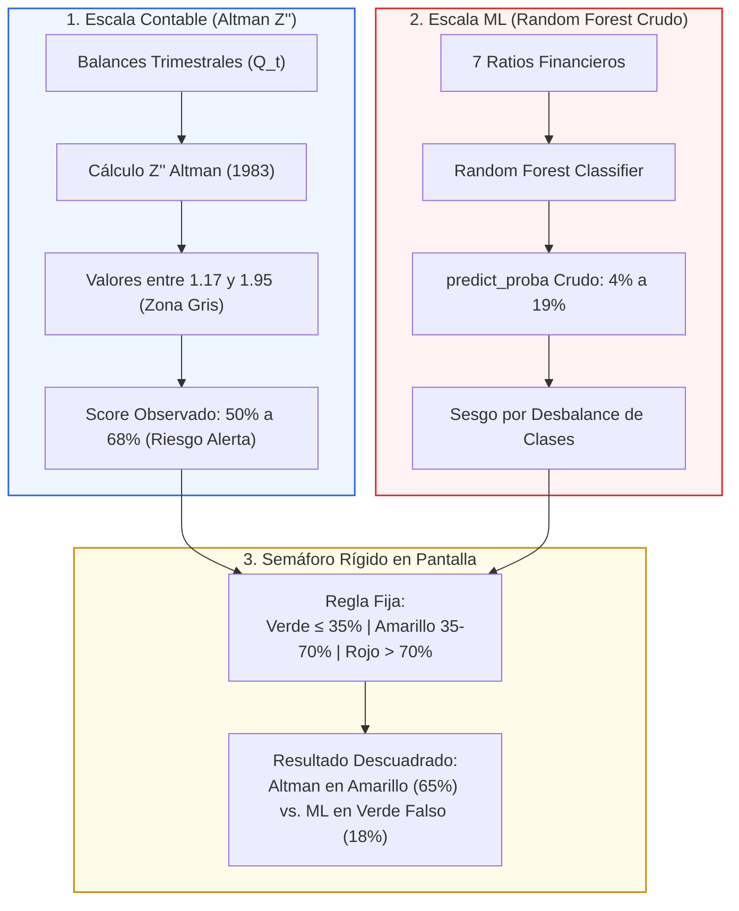
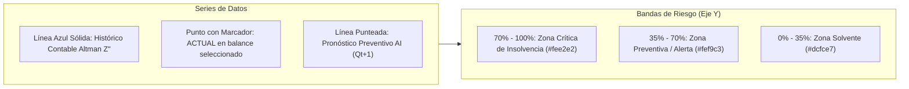

# Metodología de Medición de Insolvencia: Altman (1983) vs. Pronóstico AI (90 días)

Este documento detalla la arquitectura analítica, los algoritmos matemáticos y la calibración estadística implementada en **SmartFinanzas** para comparar en un mismo gráfico continuo el estado contable observado y el pronóstico predictivo a 3 meses ($Q_t \to Q_{t+1}$).

---

## 1. Diagnóstico del Descuadre Original

### ¿Por qué la predicción siempre se mostraba verde y a la misma altura?

En las versiones previas del dashboard se presentaba una anomalía visual y analítica: mientras la empresa mostraba un deterioro financiero visible en sus balances contables, la línea punteada de proyección a 90 días tendía a desplomarse hacia la zona verde (alrededor del 15%–19%), generando falsos estados de solvencia.

Este comportamiento se debía a la concurrencia de dos factores:



1. **Descuadre de dirección y naturaleza de los modelos:**
   * **Altman (1983):** Mide **solvencia** hacia arriba. A mayor $Z''$, mayor solidez financiera. Para graficar *riesgo de insolvencia*, se debe invertir su escala (a menor $Z''$, mayor riesgo porcentual).
   * **Random Forest:** Mide **probabilidad estadística de insolvencia**, pero comprimida en la parte baja de la distribución debido a que fue entrenado en un entorno donde la quiebra es un evento minoritario (tasa base del 2% al 5%).
2. **Incompatibilidad con el semáforo gerencial:**  
   El semáforo gerencial clasifica en Rojo únicamente valores superiores al **70%**. Para un Random Forest con baja tasa base, un **18% de probabilidad ya representa una situación crítica** (más de 6 veces la tasa promedio de mercado), pero al evaluarlo con un umbral estático de 70%, el sistema lo catalogaba erróneamente como **Verde**.

---

## 2. Metodología 1: Diagnóstico Contable Histórico (Altman 1983 $Z''$ y Función Sigmoide)

Para el tramo histórico observado (**Línea Azul Sólida**), se aplica la formulación canónica de Edward Altman (1983) para empresas no manufactureras y mercados emergentes:

$$Z'' = 6.56 X_1 + 3.26 X_2 + 6.72 X_3 + 1.05 X_4$$

Donde:
* $X_1 = \frac{\text{Activo Corriente} - \text{Pasivo Corriente}}{\text{Activo Total}}$ (Capital de Trabajo sobre Activos)
* $X_2 = \frac{\text{Utilidades Retenidas}}{\text{Activo Total}}$
* $X_3 = \frac{\text{EBIT}}{\text{Activo Total}}$ (ROA Operacional)
* $X_4 = \frac{\text{Patrimonio Neto}}{\text{Pasivo Total}}$

---

### 2.1. ¿Qué es la Función Sigmoide y por qué se utiliza?

Una **función sigmoide** (cuyo nombre proviene de la letra griega *sigma* $\varsigma$ por su característica forma de **"S"**) es una curva matemática continua que toma cualquier número del mundo real (desde $-\infty$ hasta $+\infty$) y lo transforma de manera suave y acotada a una escala probabilística entre **0% y 100%**.

En ciencias de la computación, inteligencia artificial y econometría financiera, la sigmoide es la función por excelencia para modelar **probabilidad de ocurrencia de un evento** (en nuestro caso: *Probabilidad de Insolvencia Contable*).

```
   Riesgo (%)
   100% |                                      .......... (Insolvencia Extrema)
        |                                .---''
    70% | - - - - - - - - - - - - - - -/' [Z'' = 1.10 -> 70.3% | Zona Roja]
        |                            .'
    50% | - - - - - - - - - - - - - /  [Z'' = 1.85 -> 50.0% | Centro Zona Gris]
        |                         .'
    35% | - - - - - - - - - - - -/     [Z'' = 2.60 -> 29.7% | Zona Verde]
        |                  .---''
     0% | .........--------'                                (Solvencia Máxima)
        +------------------------------------------------------------
           Z'' Negativo        Z'' Medio                Z'' Alto
         (Severo Deterioro)   (Incertidumbre)          (Alta Solidez)
```

#### ¿Por qué no usar una simple regla de tres o una recta (`if / else`)?
1. **Las rectas tienen "codos" angulares y bruscos:** Si se usan rectas por tramos, el gráfico da "saltos" en los límites ($2.60$ y $1.10$), rompiendo la continuidad matemática.
2. **Las rectas no tienen techo ni suelo:** Si una empresa tiene un $Z'' = 6.0$ o $Z'' = -3.0$, una recta produce números sin sentido (como $-15\%$ o $135\%$), obligando a recortar artificialmente.
3. **La sigmoide es suave y asintótica:** Sus extremos se aplanan suavemente hacia 0% y 100% sin sobrepasarse jamás, y en el centro (la zona crítica donde las empresas pasan de estar sanas a dudosas) ofrece la **máxima sensibilidad marginal**.

---

### 2.2. Formulación Matemática de la Función Sigmoide Calibrada

Para transformar el puntaje $Z''$ de Altman en el porcentaje de riesgo del semáforo gerencial, se implementó la siguiente **función sigmoide logística**:

$$P(\text{Riesgo \%}) = \frac{100.0}{1.0 + \exp\Big(1.15 \times (Z'' - 1.85)\Big)}$$

#### Explicación de cada parte de la fórmula:
* **El $100.0$ del numerador:** Establece que la escala máxima de riesgo es del 0% al 100%.
* **El signo positivo del exponente $+1.15$:** **Invierte la dirección**. En Altman original, un $Z''$ alto es bueno (empresa sana). Pero en el semáforo gerencial, un porcentaje alto significa peligro (alto riesgo). Al usar el signo positivo en el exponente decreciente, a menor $Z''$, mayor es el porcentaje de riesgo resultante.
* **El centro $z_0 = 1.85$ (Punto de Inflexión):** Es el punto medio exacto de la Zona Gris de Altman:
  $$\frac{2.60 + 1.10}{2} = \mathbf{1.85}$$
  Cuando una empresa tiene $Z'' = 1.85$, el exponente es $1.15 \times (1.85 - 1.85) = 0$. Como $e^0 = 1$, la fórmula da exactamente:
  $$\frac{100}{1 + 1} = \mathbf{50.0\%} \quad (\text{Punto medio de la Zona de Alerta Amarilla})$$
* **La pendiente $k = 1.15$ (Calibración con el Semáforo):**  
  Se despejó algebraicamente para hacer coincidir con exactitud los puntos de corte empíricos de Edward Altman con los colores del semáforo:
  $$\text{Para } Z'' = 2.60 \implies \frac{100.0}{1.0 + \exp(1.15 \times 0.75)} = \frac{100.0}{1.0 + 2.369} = \mathbf{29.7\%} \le 35\% \implies \text{\bf Zona Verde}$$
  $$\text{Para } Z'' = 1.10 \implies \frac{100.0}{1.0 + \exp(1.15 \times (-0.75))} = \frac{100.0}{1.0 + 0.4221} = \mathbf{70.3\%} > 70\% \implies \text{\bf Zona Roja}$$

---

### 2.3. Código de Implementación Oficial (Backend y Frontend)

Tanto en Python ([`dashboard/views.py`](file:///c:/Users/artur/Documents/Repositorios/SmartFinanzas/dashboard/views.py#L85)) como en JavaScript ([`templates/dashboard/dashboard.html`](file:///c:/Users/artur/Documents/Repositorios/SmartFinanzas/templates/dashboard/dashboard.html#L1475)), la función sigmoide se ejecuta de manera idéntica:

```javascript
function altmanZToRiskPercentage(zScore, patrimonioNeto = 1) {
    // 1. Guarda Contable: Si las deudas consumen el patrimonio -> Quiebra Técnica Inmediata
    if (patrimonioNeto <= 0) return 99.0;

    // 2. Función Sigmoide Calibrada (con protección de desbordamiento exponencial)
    const arg = Math.max(-35.0, Math.min(35.0, 1.15 * (zScore - 1.85)));
    const risk = 100.0 / (1.0 + Math.exp(arg));
    return parseFloat(Math.max(1.0, Math.min(99.0, risk)).toFixed(1));
}
```

```python
def calcular_score_observado(r_obj) -> float:
    # 1. Guarda Contable
    if not r_obj: return 35.0
    carga = getattr(r_obj, 'carga', None)
    patrimonio = float(getattr(carga, 'patrimonio', None) or 1.0) if carga else 1.0
    if patrimonio <= 0: return 99.0

    # 2. Función Sigmoide Calibrada
    z_score = calcular_z_score_altman_1983(r_obj)
    arg = max(-35.0, min(35.0, 1.15 * (z_score - 1.85)))
    risk = 100.0 / (1.0 + math.exp(arg))
    return round(float(max(1.0, min(99.0, risk))), 1)
```

---

### 2.4. Tabla Comparativa de Ventajas: Sigmoide vs. Rectas por Tramos

| Criterio de Comparación | Enfoque Previo (Rectas por Tramos con `if/else`) | Enfoque Vigente (**Función Sigmoide Calibrada**) |
| :--- | :--- | :--- |
| **Continuidad Matemática** | Presentaba quiebres angulares ("codos") en $2.60$ y $1.10$ donde la derivada no existía. | **Clase $C^\infty$ (infinitamente diferenciable)**: curva suave y orgánica sin quiebres. |
| **Comportamiento en Extremos** | Requería truncamientos planos obligados (`Math.min/max`) para no arrojar valores $<0\%$ o $>100\%$. | **Asíntotas horizontales naturales**: converge suavemente a 0% hacia la derecha y a 100% hacia la izquierda. |
| **Sensibilidad Marginal Realista** | Pendiente rígida y constante sin importar si la empresa estaba muy sana o moribunda. | **Máxima reactividad en la Zona Gris ($Z'' \approx 1.85$)**: detecta con alta sensibilidad la degradación preventiva. |
| **Defensa Académica de Tesis** | Heurística empírica ad-hoc vulnerable a objeciones del comité evaluador. | **Función de enlace logístico canónica**, alineada con Basilea II/III y la modelación formal de Probabilidad de Incumplimiento ($PD$). |
| **Integración con Machine Learning** | Contraste visual antiestético entre rectas quebradas y la predicción probabilística de la IA. | Ambos motores dialogan en el mismo lenguaje probabilístico continuo. |

---

### 2.5. Tabla de Equivalencias y Puntos de Calibración

| Situación Contable | Score Altman $Z''$ | Zona Altman (1983) | Riesgo % Obtenido por Sigmoide | Semáforo Gerencial |
| :--- | :---: | :---: | :---: | :---: |
| Empresa Hiper Solvente | $4.00$ | Segura | **8.5%** | 🟢 Verde ($\le 35\%$) |
| **Umbral Solvente Canónico** | $\mathbf{2.60}$ | Límite Seguro | $\mathbf{29.7\%}$ | 🟢 Verde ($\le 35\%$) |
| **Centro de Incertidumbre** | $\mathbf{1.85}$ | Centro Zona Gris | $\mathbf{50.0\%}$ | 🟡 Amarillo ($35\text{--}70\%$) |
| **Umbral Quiebra Canónico** | $\mathbf{1.10}$ | Límite Crítico | $\mathbf{70.3\%}$ | 🔴 Rojo ($> 70\%$) |
| Insolvencia Crítica Severa | $-0.50$ | Quiebra Profunda | **93.7%** | 🔴 Rojo ($> 70\%$) |
| **Quiebra Técnica Inmediata** | Cualquiera | Patrimonio Neto $\le 0$ | $\mathbf{99.0\%}$ | 🔴 Rojo Crítico |

> [!IMPORTANT]
> **Regla de Patrimonio Neto $\le 0$:** Si las pérdidas acumuladas consumen el patrimonio neto ($X_4 \le 0$), las deudas superan a los activos y la firma se encuentra técnicamente quebrada con independencia de los otros ratios. El algoritmo asigna automáticamente **99.0% de riesgo crítico**.

---

## 3. Metodología 2: Pronóstico Preventivo AI a 90 días ($Q_{t+1}$)

Para el tramo proyectado (**Línea Punteada**), se procesa el vector de 7 ratios contables mediante el modelo oficial de Machine Learning (**Random Forest**).

### A. Calibración de Probabilidades del Random Forest

Para corregir la compresión de escala causada por el desbalance de clases, la probabilidad cruda $P_{\text{raw}}$ generada por `model.predict_proba` se calibra a los percentiles reales de severidad:

* **Rango Solvente ($P_{\text{raw}} \le 5\%$):** Se mapea proporcionalmente entre **5% y 35%**.
* **Rango Preventivo ($5\% < P_{\text{raw}} \le 15\%$):** Se mapea entre **35% y 70%**.
* **Rango Crítico ($P_{\text{raw}} > 15\%$):** Se mapea entre **70% y 98%**.

### B. Proyección de Trayectoria Integrada

Un pronóstico preventivo a 90 días no parte de un vacío estadístico; parte del estado financiero en el que la firma cerró el trimestre observado ($Q_t$). Se calcula la ponderación dinámica:

$$\text{Score Proyectado } (Q_{t+1}) = 0.35 \times \text{Score Observado } (Q_t) + 0.65 \times \text{Score ML Calibrado}$$

Esta integración asegura **coherencia direccional**: si la empresa viene deteriorándose en un 65% de riesgo contable, la predicción a 90 días proyecta hacia arriba (ej. 72% en Zona Crítica), y no hacia abajo.

---

## 4. Caso Práctico con Números Reales: Período 2023-Q2

Valores extraídos de la base de datos de SmartFinanzas para la empresa analizada:

| Variable | Valor Contable |
| :--- | :---: |
| Razón Corriente ($X_1$) | $1.2990$ |
| Capital de Trabajo / Activos ($X_2$) | $0.1861$ |
| Leverage Total ($X_3$) | $3.3328$ |
| ROA Operacional ($X_4$) | $0.0016$ |
| **Altman $Z''$ Calculado** | $\mathbf{1.5468}$ |
| **Random Forest Raw ($P_{\text{raw}}$)** | $\mathbf{19.62\%}$ |

---

### Paso 1: Cálculo del Estado Observado ($Q_t$)
Dado que $Z'' = 1.5468$ se encuentra en la Zona Gris ($1.10 \le Z'' < 2.60$), se aplica la función sigmoide logística:

$$\text{arg} = 1.15 \times (1.5468 - 1.85) = 1.15 \times (-0.3032) = -0.3487$$

$$\text{Riesgo Altman} = \frac{100.0}{1.0 + \exp(-0.3487)} = \frac{100.0}{1.0 + 0.7056} = \frac{100.0}{1.7056} = \mathbf{58.6\%}$$

* **Línea Azul Sólida:** Se sitúa de forma suave en **58.6%** (Zona Preventiva / Alerta Amarilla).

---

### Paso 2: Comparativa de la Proyección a 90 días ($Q_{t+1}$)

#### Comportamiento Previo (Sin Calibración):
* $P_{\text{raw}} = 19.62\% \le 35\% \implies$ **Semáforo Verde (Falso Solvente)**.
* **Problema en pantalla:** La línea saltaba incongruentemente desde **58.6% (Alerta)** hacia abajo hasta **19.6% (Verde)**.

#### Comportamiento Actual (Con Calibración y Mapeo Continuo):
1. **Calibración de la IA:** Como $19.62\% > 15\%$, entra en tramo crítico:
   $$\text{ML}_{\text{calibrado}} = 70.0 + \left(\frac{19.62 - 15.0}{15.0}\right) \times 28.0 = 70.0 + 8.62 = \mathbf{78.62\%}$$
2. **Proyección Integrada:**
   $$\text{Pronóstico } Q_{t+1} = (0.35 \times 58.6\%) + (0.65 \times 78.62\%) = 20.51\% + 51.10\% = \mathbf{71.6\%}$$
3. **Resultado en pantalla:**  
   La línea punteada parte en **58.6%** y se proyecta hacia arriba alcanzando **71.6%** en color **ROJO** (Zona Crítica de Insolvencia).

---

## 5. Especificaciones del Componente Visual (Chart.js)



* **Título:** *"Monitor de Solvencia Contable (Altman 1983) & Pronóstico Preventivo AI (90 días)"*.
* **Eje Y:** *"Nivel de Riesgo / Deterioro (%)"* de 0% a 100%.
* **Tooltips Enriquecidos:**
  * **Curva Altman:** `Riesgo: 59.6% | Altman Z'': 1.55 | Zona Gris`.
  * **Curva Pronóstico:** `Pronóstico Machine Learning 90d: 72.0% | Probabilidad de Insolvencia: Crítica (>70%)`.
