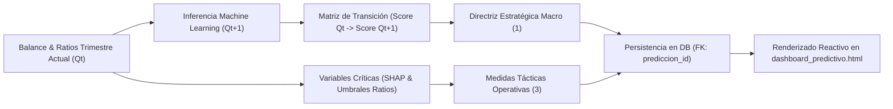

# Plan Estratégico de Recomendaciones Financieras y Alerta Temprana a 90 Días ($Q_t \to Q_{t+1}$)

**Sistema:** SmartFinanzas — Módulo Predictivo y Preservación de Solvencia  
**Marco Regulatorio:** Ley 20.720 de Reorganización y Liquidación de Empresas y Personas (modernizada por Ley 21.563 de 2023, República de Chile)  
**Horizonte de Anticipación:** 90 Días ($Q_t \to Q_{t+1}$, Período Actual a Período Proyectado)  
**Estilo de Comunicación:** Lenguaje Ejecutivo Accesible (*Business Plain Spanish*)  
**Autoría Técnica:** Arquitectura de Software & Ingeniería Financiera  

---

## 1. Resumen Ejecutivo

El presente documento establece formalmente el diseño de ingeniería, la fundamentación empírica en literatura chilena, la calibración de lenguaje y la arquitectura de datos del **Sistema de Recomendaciones Financieras y Planes de Acción Preventivos** integrado en el `dashboard_predictivo` de **SmartFinanzas**.

A diferencia de un diagnóstico contable retrospectivo tradicional —que se limita a describir el pasado— este subsistema opera con un **enfoque prescriptivo anticipatorio**:
1. Examina el estado de salud financiera del trimestre cerrado actual ($Q_t$).
2. Evalúa simultáneamente la probabilidad de insolvencia proyectada por los modelos de Machine Learning para los próximos 90 días ($Q_{t+1}$).
3. Selecciona una **Directriz Estratégica Macro** correspondiente al cuadrante de transición de riesgo ($3 \times 3$).
4. Identifica las variables financieras críticas dominantes ($X_1$ a $X_7$) y genera **Medidas Tácticas Operativas** con diagnósticos en proporciones monetarias cotidianas ("qué hacer paso a paso").
5. Vincula unívocamente todo el plan a la clave primaria del período evaluado (`prediccion_id`) en la tabla `recomendacion`, permitiendo auditoría histórica y reactividad inmediata en la interfaz.



---

## 2. Fundamentación Teórica y Literatura Empírica Chilena

El diseño de las directrices y acciones preventivas se sustenta directamente en investigaciones econométricas del mercado financiero chileno y en el marco legal concursal vigente:

### A. Zurita, Felipe (2008) — *La predicción de la insolvencia de empresas chilenas* (Revista Economía Chilena, Banco Central de Chile)
* **Hallazgo Clave:** En las empresas en Chile, el riesgo de insolvencia no depende únicamente del monto total de endeudamiento, sino críticamente de la **composición temporal de las deudas** (proporción de pasivo circulante sobre pasivo total) y del costo de financiamiento.
* **Directriz Aplicada:** Alargar el perfil de vencimientos mediante créditos comerciales a 24-36 meses para unificar deudas bancarias de corto plazo, reduciendo el monto de las cuotas mensuales y evitando el ahogo financiero.

### B. Ringeling, Eduardo (2004) — *Análisis comparativo de modelos de predicción de quiebra y la probabilidad de bancarrota* (Universidad de Chile)
* **Hallazgo Clave:** Introduce la **volatilidad del flujo de caja operativo** ($X_7$) como variable determinante. Una dispersión errática entre cobros y pagos precipita la quiebra técnica por descalce transitorio, aun con empresas operativamente viables.
* **Directriz Aplicada:** Implementación de presupuestos semanales de tesorería a 90 días, incentivos por pronto pago (2% a 3%) para acelerar la entrada de dinero y constitución de reservas de seguridad para gastos fijos de 30 a 45 días.

### C. Riquelme, Valeria (2018) — *Evaluación de la capacidad de pronóstico de modelos predictivos de quiebra en Chile y Brasil* (Universidad del Bío-Bío)
* **Hallazgo Clave:** Analiza empresas bajo norma contable IFRS en Chile y demuestra que el **Margen Operacional** ($X_5$) y el **ROA Operacional** ($X_4$) son los indicadores con mayor capacidad de pronóstico temprano (12 a 24 meses de anticipación).
* **Directriz Aplicada:** Revisión estricta de precios de venta en líneas que dejan escaso margen, suspensión de descuentos comerciales automáticos y priorización de productos de mayor rentabilidad neta.

### D. Ley 20.720 de Reorganización y Liquidación de Empresas y Personas (Chile, modernizada por Ley 21.563 de 2023)
* **Hallazgo Clave:** Regula el salvamento de empresas viables en dificultades financieras antes de la cesación forzosa de pagos. Establece la **Protección Financiera Concursal (PFC)** dentro del Procedimiento de Reorganización Judicial (Art. 54 y ss.), que suspende órdenes de embargo, ejecuciones de cobro y remates mientras se acuerda un convenio con acreedores.
* **Directriz Aplicada:** Cuando el negocio ingresa o proyecta mantenerse en **Riesgo Crítico (>70%)**, se orienta a la administración hacia la asesoría legal para evaluar las herramientas de reorganización preventiva que prevé la ley chilena.

### E. Altman, Edward I. (1983) — *Corporate Financial Distress / Emerging Market Score (EMS)*
* **Hallazgo Clave:** Modelo para mercados emergentes y empresas manufactureras/no manufactureras. Destaca el papel primordial del **Capital de Trabajo sobre Activos** ($X_2$) como el colchón básico de liquidez de la firma.
* **Directriz Aplicada:** Preservación del fondo de maniobra positivo impidiendo retiros de socios en períodos de fragilidad financiera.

---

## 3. Calibración del Tono: Lenguaje Ejecutivo Accesible (*Business Plain Spanish*)

Para asegurar que las recomendaciones sean comprensibles y accionables tanto por gerentes generales como por dueños de pymes o directores no financieros, el sistema implementa un estilo de redacción rigurosamente calibrado:

| Criterio | Enfoque Descartado | Calibración Implementada (Aprobada) |
| :--- | :--- | :--- |
| **Jerga Financiera** | Evitar anglicismos y siglas abstractas (*CAPEX, OPEX, Rolling Forecast, Cash-Flow Volatility, Covenant*). | **Términos claros y cotidianos:** Inversiones en bienes y equipos, gastos del mes, presupuesto semanal de caja, compromisos bancarios. |
| **Comprensión de Ratios** | Evitar fórmulas matemáticas aisladas (*"RC = 1.17x, Z-Score = 2.1"*). | **Proporciones en dinero real:** *"Por cada $1.000 que debe pagar en el mes, dispone de $1.170 en recursos inmediatos..."* |
| **Nivel de Formalidad** | Evitar tanto el tecnicismo académico como el tono coloquial o informal (*"no uses la tarjeta", "anda al banco", "plata"*). | **Formal, serio y fiduciario:** *"Solicitar a las entidades bancarias la consolidación de deudas de corto plazo en un crédito a 36 meses..."* |
| **Aplicabilidad** | Evitar recomendaciones teóricas genéricas (*"optimice sus procesos"*). | **Medidas concretas:** Negociar con proveedores a 60 días, pedir anticipos del 30% en pedidos grandes, solicitar convenio de cuotas en Tesorería (TGR). |

### Reglas de Transformación Numérica en Plantillas de Diagnóstico:
1. **Razón Corriente ($X_1$):** Se traduce a pesos disponibles por cada mil pesos adeudados:
   $$\text{Cobertura} = \$\text{int}(X_1 \times 1.000)$$
   *Ejemplo:* $X_1 = 1.17 \implies \text{"Por cada \$1.000 que debe pagar, dispone de \$1.170..."}$
2. **Margen Operacional ($X_5$):** Se traduce a ganancia limpia por cada cien mil pesos facturados:
   $$\text{Margen en Pesos} = \$\text{int}(X_5 \times 100.000)$$
   *Ejemplo:* $X_5 = 4.6\% \implies \text{"Por cada \$100.000 vendidos, a la empresa le quedan \$4.610 de ganancia..."}$
3. **Endeudamiento sobre Patrimonio / Leverage ($X_3$):** Se expresa en multiplicador directo sin símbolos monetarios confusos:
   $$\text{Multiplicador} = X_3\text{ veces el patrimonio}$$
   *Ejemplo:* $X_3 = 4.81 \implies \text{"El nivel de deuda supera en 4.8 veces el patrimonio aportado por los dueños..."}$
4. **Capital de Trabajo ($X_2$) y Rentabilidad ($X_4$):** Se expresan en porcentaje limpio:
   *Ejemplo:* $X_2 = 12.7\% \implies \text{"El capital disponible para el día a día representa el 12.7% de los activos..."}$

---

## 4. Matriz de Decisión Intertemporal ($Q_t \to Q_{t+1}$)

El motor clasifica el score de riesgo observado del período actual ($Score_{Q_t}$) y el proyectado ($Score_{Q_{t+1}}$) en tres bandas:
* **Verde (Solvente):** $Score \le 35.0\%$
* **Amarillo (Alerta Preventiva):** $35.0\% < Score \le 70.0\%$
* **Rojo (Riesgo Crítico):** $Score > 70.0\%$

```
                                              ESTADO PROYECTADO (Qt+1)
                                 VERDE (<=35%)       AMARILLO (35-70%)         ROJO (>70%)
                             +--------------------+---------------------+---------------------+
           VERDE (<=35%)     | MACRO-V-V:         | MACRO-V-A:          | MACRO-V-R:          |
                             | Consolidación y    | Alerta Preventiva:  | Freno de Emergencia:|
                             | Crecimiento        | Contención Liquidez | Blindaje de Caja    |
                             +--------------------+---------------------+---------------------+
ESTADO     AMARILLO          | MACRO-A-V:         | MACRO-A-A:          | MACRO-A-R:          |
ACTUAL     (35-70%)          | Retorno a Zona     | Mitigación &        | Alerta Crítica:     |
 (Qt)                        | de Seguridad       | Reprogramación      | Reestructuración    |
                             +--------------------+---------------------+---------------------+
           ROJO (>70%)       | MACRO-R-V:         | MACRO-R-A:          | MACRO-R-R:          |
                             | Recuperación       | Desescalamiento de  | Plan de Emergencia: |
                             | Favorable          | Insolvencia         | Reorganización 20720|
                             +--------------------+---------------------+---------------------+
```

### Inventario de las 9 Directrices Estratégicas Macro:
1. **`MACRO-V-V` (Verde $\to$ Verde):** *Consolidación de la Estabilidad Financiera y Reinversión Prudente.* Negociar mejores tasas y constituir fondo de reserva de 30-45 días de gastos habituales.
2. **`MACRO-V-A` (Verde $\to$ Amarillo):** *Alerta Preventiva: Contención de Liquidez ante Deterioro Proyectado.* Postergar inversiones no urgentes y acordar pagos con proveedores a 60 días para proteger la caja.
3. **`MACRO-V-R` (Verde $\to$ Rojo):** *Freno de Emergencia: Blindaje Inmediato de Caja por Deterioro Acelerado.* Congelar desembolsos prescindibles, incentivar pronto pago y blindar líneas de crédito.
4. **`MACRO-A-V` (Amarillo $\to$ Verde):** *Consolidación del Retorno a la Zona de Seguridad.* Mantener el control de compras y destinar excedentes a liquidar deudas de mayor interés bancario.
5. **`MACRO-A-A` (Amarillo $\to$ Amarillo):** *Mitigación de Vulnerabilidad y Reprogramación de Vencimientos.* Reprogramar compromisos del mes hacia cuotas a 24-36 meses y liquidar mercadería de baja rotación.
6. **`MACRO-A-R` (Amarillo $\to$ Rojo):** *Alerta Crítica: Reestructuración Urgente de Deudas Exigibles.* Solicitar meses de gracia a los bancos y asegurar con prioridad remuneraciones e imposiciones.
7. **`MACRO-R-V` (Rojo $\to$ Verde):** *Sostenimiento de la Recuperación y Protección de la Caja.* Rigor estricto en pagos acordados y prohibición de asumir nuevas deudas sin respaldo comprobado.
8. **`MACRO-R-A` (Rojo $\to$ Amarillo):** *Desescalamiento de Insolvencia: Cumplimiento de Acuerdos de Pago.* Renegociar costos fijos (arriendos y servicios) y control diario de saldo en cuenta corriente.
9. **`MACRO-R-R` (Rojo $\to$ Rojo):** *Plan de Emergencia: Reorganización Legal Preventiva (Ley 20.720).* Evaluar con asesoría legal el procedimiento concursal para obtener Protección Financiera Concursal antes de una liquidación forzosa.

---

## 5. Catálogo de Recomendaciones Tácticas Operativas

Para cada una de las variables canónicas, el sistema evalúa su severidad individual mediante la función `evaluar_severidad_variable(var_clave, v_dict, nivel_proy, nivel_act)`:

| Variable | Ratio / Significado | Umbral Crítico | Umbral Alerta | Umbral Solvente |
| :--- | :--- | :--- | :--- | :--- |
| **$X_1$ Razón Corriente** | Activo Circulante / Pasivo Circulante | $< 1.05\text{x}$ | $1.05 - 1.35\text{x}$ | $\ge 1.35\text{x}$ |
| **$X_2$ Capital de Trabajo / Activos** | (Act. Circ. - Pas. Circ.) / Activos | $< 5.0\%$ | $5.0\% - 18.0\%$ | $\ge 18.0\%$ |
| **$X_3$ Leverage Total** | Pasivo Total / Patrimonio Neto | $> 2.50\text{x}$ | $1.40 - 2.50\text{x}$ | $< 1.40\text{x}$ |
| **$X_4$ ROA Operacional** | EBIT / Activo Total | $< 2.0\%$ | $2.0\% - 7.0\%$ | $\ge 7.0\%$ |
| **$X_5$ Margen Operacional** | EBIT / Ventas Netas | $< 3.0\%$ | $3.0\% - 8.0\%$ | $\ge 8.0\%$ |
| **$X_6$ Rotación de Activos** | Ventas / Activo Total | $< 0.60\text{x}$ | $0.60 - 1.10\text{x}$ | $\ge 1.10\text{x}$ |
| **$X_7$ Volatilidad Flujo de Caja** | Coeficiente de variación tesorería | $> 1.20$ | $0.60 - 1.20$ | $< 0.60$ |

Cada tarjeta táctica contiene tres campos estructurados:
1. **Situación Actual (`diagnostico_operativo`):** Diagnóstico cuantitativo contextualizado en dinero real o proporciones.
2. **Acción Recomendada (`que_hacer`):** Directriz ejecutiva clara de lo que debe realizar la empresa en el trimestre.
3. **Paso a Paso Sugerido (`procedimiento`):** Checklist de 2 a 3 acciones operativas concretas.

---

## 6. Persistencia y Vinculación en Base de Datos

Las recomendaciones se almacenan de forma determinista en la tabla `recomendacion` del esquema de base de datos MySQL:

```sql
CREATE TABLE `recomendacion` (
  `id` bigint(20) NOT NULL AUTO_INCREMENT,
  `variable_origen` varchar(50) DEFAULT NULL,
  `grupo_riesgo` varchar(40) DEFAULT NULL,
  `texto` longtext DEFAULT NULL,
  `prioridad` varchar(10) DEFAULT NULL,
  `prediccion_id` bigint(20) NOT NULL,
  PRIMARY KEY (`id`),
  KEY `recomendacion_prediccion_id_fk` (`prediccion_id`),
  CONSTRAINT `recomendacion_prediccion_id_fk` FOREIGN KEY (`prediccion_id`) REFERENCES `prediccion_riesgo` (`id`) ON DELETE CASCADE
) ENGINE=InnoDB DEFAULT CHARSET=utf8mb4;
```

### Garantía de Trazabilidad:
* Cada predicción tiene su ID (por ejemplo `#8` para el período `2023-Q4`).
* La tabla `recomendacion` almacena 4 filas vinculadas por `prediccion_id`:
  - 1 fila para la recomendación macro (`variable_origen = 'macro_transicion'`).
  - 3 filas para las medidas tácticas dominantes (`variable_origen = 'capital_trabajo_sobre_activos'`, `'leverage_total'`, etc.).
* El campo `texto` contiene el objeto estructurado serializado en JSON (título, situación actual, acción, procedimiento y fuente bibliográfica), permitiendo evolución sin requerir alteraciones al esquema DDL.

---

## 7. Integración en Interfaz de Usuario (`dashboard_predictivo.html`)

### A. Jerarquía Visual:
La sección se ubica **inmediatamente debajo de Monitoreo** y **antes de Factores Determinantes de la Proyección**:
1. **Métricas de Cabecera y Horizonte ($Q_t \to Q_{t+1}$)**
2. **Monitoreo (Curva de Tendencia y Proyección)**
3. **Plan de Acción y Recomendaciones Estratégicas a 90 Días** *(Componente Principal)*
   - Banner Macro de Transición con borde cromático (`#16a34a`, `#ca8a04`, `#dc2626`).
   - Grilla de 3 tarjetas tácticas con recuadros diferenciados para **Situación Actual**, **Acción Recomendada** y **Paso a Paso Sugerido**.
4. **Factores Determinantes de la Proyección (Top 3 Variables)**
5. **Matriz de Validación Histórica (Backtesting Retrospectivo)**
6. **Trazabilidad Integral: Ratios Calculados del Balance Base**

### B. Reactividad en Tiempo Real sin Recarga:
* Cuando el usuario hace clic sobre un trimestre histórico o utiliza los filtros de período, la función JavaScript `posicionarEnPeriodo(periodo)` invoca `actualizarSeccionRecomendaciones(puntoActivo)`.
* Las recomendaciones se leen del diccionario precargado en memoria `recomendacionesPorPeriodo[puntoActivo.id]`.
* El DOM se actualiza de manera instantánea (badges, textos explicativos, porcentajes y listas de pasos) manteniendo la coherencia visual y fiduciaria.

---

## 8. Verificación y Resultados en Producción

### Validación de la Suite Django:
```powershell
.\venv\Scripts\python.exe manage.py check
# Resultado: System check identified no issues (0 silenced).
```

### Comprobación de Registros en Base de Datos:
* Total de evaluaciones históricas de la empresa de prueba (`coagra`): **8 trimestres**.
* Total de recomendaciones persistidas en tabla `recomendacion`: **32 registros** (4 registros por cada período).

### Caso de Prueba — Período Activo `2023-Q4` (ID #8):
* **Score Observado ($Q_t$):** $16.8\%$ (Verde)
* **Score Proyectado a 90 días ($Q_{t+1}$):** $70.0\%$ (Límite Amarillo / Alerta Preventiva)
* **Recomendación Macro Disparada:**
  - `MACRO-V-A: Alerta Preventiva: Contención de Liquidez ante Deterioro Proyectado`
  - *Acción Principal:* Postergar compras de bienes o maquinarias no urgentes y pactar pagos a proveedores a 60 días para proteger el saldo en cuenta corriente.
* **Medidas Tácticas Seleccionadas:**
  1. **Leverage Total (Prioridad Alta):** *Reprogramación de Deudas de Corto Plazo a Mayor Plazo.*
     - *Situación Actual:* "El nivel de deuda actual supera en 4.8 veces el patrimonio aportado por los dueños de la empresa. Gran parte del negocio está financiado por bancos y proveedores..."
     - *Acción:* Solicitar al banco consolidar pasivos corrientes en crédito comercial a 36 meses y solicitar convenio de cuotas en Tesorería (TGR).
  2. **Capital de Trabajo (Prioridad Media):** *Ajuste del Fondo de Reserva para Operaciones.*
     - *Situación Actual:* "El capital disponible para el día a día representa el 12.7% del total de recursos de la empresa, un nivel que aconseja prudencia en la programación de compras."
     - *Acción:* Planificar compras de insumos según ventas reales del mes para no inmovilizar dinero en bodega.
  3. **ROA Operacional (Prioridad Media):** *Aumento en el Uso y Productividad de las Instalaciones.*
     - *Situación Actual:* "El rendimiento de los activos se sitúa en un nivel modesto (12.7%), lo que indica que se puede producir o vender más con la misma infraestructura que ya se tiene."
     - *Acción:* Optimizar turnos de trabajo y enfocar la venta en productos de alta rotación.

---

## 9. Conclusión

El Sistema de Recomendaciones Predictivas a 90 Días de **SmartFinanzas** transforma la analítica de insolvencia en una herramienta directiva de alta utilidad práctica: combina la precisión predictiva de Machine Learning con el respaldo de la literatura económica chilena, comunicando las decisiones críticas en un lenguaje formal, claro y accesible para la toma de decisiones empresariales.
