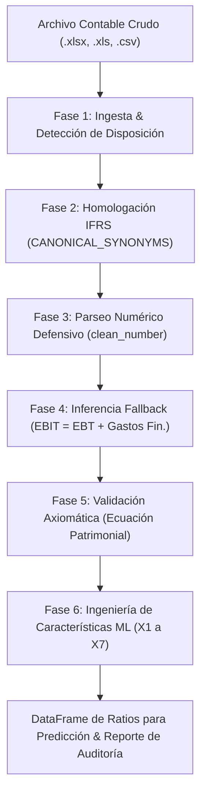

# Metodología y Pipeline de Transformación Contable IFRS / CMF a Ratios Predictivos ML

**Sistema:** SmartFinanzas — Módulo ETL Financiero Desacoplado (`moduloETL/etl_financiero.py`)  
**Estándar Contable:** Normas Internacionales de Información Financiera (NIIF / IFRS adoptadas por la Comisión para el Mercado Financiero - CMF)  
**Entorno de Procesamiento:** Python puro en memoria (Pandas, NumPy, OpenPyXL) sin dependencias de base de datos durante la ingesta  
**Autoría Técnica:** Arquitectura de Datos & Machine Learning  

---

## 1. Introducción y Necesidad del Pipeline de Transformación

En la República de Chile, desde la adopción oficial de las **Normas Internacionales de Información Financiera (IFRS / NIIF)** coordinada por la CMF (ex SVS) y el Colegio de Contadores, la presentación de balances y estados de resultados cuenta con una taxonomía formal estandarizada.

Sin embargo, en el mundo real de las empresas y sistemas ERP (como Facto, Defontana, Softland o planillas Excel de estudios contables), los archivos presentan severas discrepancias que impiden su procesamiento algorítmico directo:
1. **Heterogeneidad de nomenclatura:** La cuenta *Activo Circulante* puede figurar como *"Total de Activos Corrientes"*, *"Activos Corrientes Totales"*, *"Activo Circulante"* o la denominación formal CMF: *"Total de activos corrientes distintos de los activos mantenidos para la venta"*.
2. **Ambigüedad en signos y tipografía:** Montos negativos expresados en paréntesis contables `(45.000.000)`, símbolos monetarios intercalados (`$`, `UF`, `USD`), espacios no separables y discrepancias de separadores de miles (puntos vs. comas).
3. **Estructuras espaciales contrapuestas:** Formato horizontal oficial CMF (columnas = cuentas, filas = trimestres) versus balances verticales tradicionales de PYMES (filas = cuentas, columnas = períodos).
4. **Desbalances patrimoniales:** Diferencias contables por redondeo o cuadres forzados que violan la ecuación fundamental de la partida doble.

Para resolver este desafío, **SmartFinanzas** implementa un motor ETL desacoplado (`FinancialETLProcessor`) que aplica homologación léxica, parseo numérico defensivo, saneamiento de axiomas contables y normalización adimensional para alimentar el modelo predictivo de Machine Learning.



---

## 2. Fase 1: Ingesta y Detección de Disposición Espacial

El motor acepta polimórficamente archivos desde rutas de disco (`Path`), buffers de memoria (`BytesIO` o `UploadedFile` de Django) o `DataFrames` en Pandas.

### Formato Horizontal Exclusivo (Estándar CMF):
El sistema procesa **exclusivamente archivos en formato horizontal**:
* **Encabezados de Columnas:** Cuentas contables canónicas (ej. *Activo Total, Pasivo Circulante, Ingresos de Actividades Ordinarias*).
* **Filas:** Períodos contables trimestrales o anuales históricos (ej. *2022-Q1, 2022-Q2, ..., 2023-Q4*).

> [!IMPORTANT]
> **Detección y Rechazo Controlado de Formato Vertical:**  
> Si el algoritmo escanea las primeras 15 columnas y detecta que las cuentas contables se encuentran dispuestas como filas y las fechas como columnas (formato vertical de reporte impreso), el procesador lanza una excepción explicativa `InvalidFormatError`, instruyendo al contador a transponer las cuentas a columnas antes de procesar el archivo.

---

## 3. Fase 2: Diccionario de Homologación Contable IFRS / CMF

Para desacoplar el sistema de la redacción exacta que utilice cada software contable, se implementa la función `normalize_text(text)` y el catálogo maestro `CANONICAL_SYNONYMS`:

### Normalización Textual (`normalize_text`):
1. Conversión de la cadena a minúsculas y eliminación de espacios en los extremos (`strip().lower()`).
2. Descomposición canónica Unicode (NFKD) para suprimir tildes, diéresis y caracteres especiales (`Á -> a`, `é -> e`, `ñ -> n`).
3. Eliminación de caracteres no alfanuméricos mediante expresión regular (`re.sub(r'[^a-z0-9]', '', s)`).

*Ejemplo:*  
`"Ganancias (pérdidas) de actividades operacionales"` $\longrightarrow$ `gananciasperdidasdeactividadesoperacionales`

### Mapeo Canónico de Cuentas:

| Cuenta Canónica | Cuentas Homologadas en IFRS / CMF / ERPs |
| :--- | :--- |
| **`Activo_Circulante`** | `activoscorrientestotales`, `totalactivoscorrientes`, `totaldeactivoscorrientes`, `activocirculante`, `totalactivocirculante`, `activoscorrientes`, `activocorriente`, `totaldeactivoscorrientesdistintosdelosactivogrupos...` |
| **`Pasivo_Circulante`** | `pasivoscorrientestotales`, `totalpasivoscorrientes`, `totaldepasivoscorrientes`, `pasivocirculante`, `totalpasivocirculante`, `pasivoscorrientes`, `pasivocorriente`, `totaldepasivoscorrientesdistintosdelospasivos...` |
| **`Activo_Total`** | `totaldeactivos`, `totalactivos`, `activototal`, `activostotales` |
| **`Pasivo_Total`** | `totaldepasivos`, `totalpasivos`, `pasivototal`, `pasivostotales` |
| **`Patrimonio_Neto`** | `patrimoniototal`, `patrimonioneto`, `totalpatrimonio`, `totalpatrimonioneto`, `patrimonio`, `patrimonioatribuiblealospropietariosdelacontroladora` |
| **`Utilidades_Retenidas`** | `gananciasperdidasacumuladas`, `utilidadesacumuladas`, `utilidadesretenidas`, `gananciasacumuladas`, `resultadosacumulados`, `utilidadacumulada` |
| **`Ingresos_Netos`** | `ingresosdeactividadesordinarias`, `ingresosordinarios`, `ventasnetas`, `ingresosnetos`, `ingresosoperacionales`, `ingresosdeexplotacion`, `ingresostotales`, `ventas` |
| **`EBIT`** | `gananciasperdidasdeactividadesoperacionales`, `resultadooperacional`, `ebit`, `utilidadoperacional`, `resultadodeexplotacion`, `gananciaoperacional` |
| **`Ganancia_Antes_Impuestos`** | `gananciaperdidaantesdeimpuestos`, `gananciaantesdeimpuestos`, `resultadoantesdeimpuestoalarenta`, `resultadoantesdeimpuestos`, `utilidadantesdeimpuestos`, `ebt` |
| **`Costos_Financieros`** | `costosfinancieros`, `gastosfinancieros`, `gastosporinteresesyreajustes` |
| **`Flujo_Operacional`** | `flujosdeefectivonetosprocedentesdeutilizadosenactividadesdeoperacion`, `flujosdeefectivoprocedentesdeutilizadosenactividadesdeoperacion`, `flujodeefectivooperacional`, `flujooperacional` |

---

## 4. Fase 3: Parseo Numérico Defensivo (`clean_number`)

Los números contables reportados por distintas fuentes en Chile combinan diversos estilos tipográficos. La función `clean_number(val)` normaliza cualquier entrada a un flotante (`float` de Python) sin perder precisión ni generar excepciones:

1. **Valores nulos o vacíos:** `None`, `""` o `NaN` de Pandas se convierten en `0.0`.
2. **Detección de paréntesis contables:** Si el texto inicia con `(` y termina con `)`, se extrae el interior y se antepone el signo negativo:
   `"(12.850.000)"` $\longrightarrow$ `"-12.850.000"`
3. **Limpieza de signos de divisa:** Supresión de `$`, `€`, `£`, `UF` y espacios en blanco.
4. **Normalización de puntuación numérica:**
   * Si contiene puntos y comas (`15.149.324,50`), se eliminan los puntos (miles) y la coma se sustituye por punto (decimal) $\longrightarrow$ `15149324.50`.
   * Si contiene múltiples puntos (`15.149.324`), se eliminan los puntos $\longrightarrow$ `15149324.0`.
   * Si contiene solo comas (`15149324,50`), se sustituye por punto $\longrightarrow$ `15149324.50`.

---

## 5. Fase 4: Reglas de Inferencia y Fallback Contable

En balances IFRS abreviados o generados por ERPs de PYMES, es habitual que la cuenta de **EBIT (Resultado Operacional)** no se encuentre detallada de manera explícita. El motor ETL aplica una regla de fallback de acuerdo a la estructura estándar del Estado de Resultados:

$$\text{EBIT} = \text{Ganancia Antes de Impuestos (EBT)} + \text{Costos Financieros}$$

Si el campo `EBIT` se encuentra ausente o en cero, y existen valores en `Ganancia_Antes_Impuestos` o `Costos_Financieros`:
* El procesador calcula automáticamente el EBIT sumando ambos conceptos.
* Se registra una advertencia formal de auditoría en `_warnings` documentando la fórmula aplicada y los montos involucrados.
* Las cuentas no críticas ausentes (`Flujo_Operacional`, `Utilidades_Retenidas`) se inicializan de forma prudencial en `0.0`.

---

## 6. Fase 5: Validaciones Axiomáticas y Control de Integridad Contable

Antes de calcular cualquier indicador, el procesador verifica 4 axiomas contables fundamentales:

### Axioma 1: Existencia de Activo Total Mayor a Cero
$$\text{Activo Total} > 0$$
Si en algún trimestre el Activo Total es menor o igual a cero, se aborta la ejecución con un `ETLValidationError` bloqueante, ya que representa un balance física y matemáticamente nulo.

### Axioma 2: Verificación de la Ecuación Patrimonial Fundamental
$$\text{Desbalance} = |\text{Activo Total} - (\text{Pasivo Total} + \text{Patrimonio Neto})|$$
$$\text{Desbalance Relativo} = \frac{\text{Desbalance}}{\text{Activo Total}}$$

* **Criterio de Tolerancia:** Se admite un desbalance de hasta un **$5.00\%$** del Activo Total para absorber pequeñas discrepancias por redondeo en balances resumidos.
* **Cuadratura Exitosa ($\le 5\%$):** El balance se clasifica como `cuadrado: true`.
* **Descuadre Severo ($> 5\%$):** Se emite una alerta de advertencia en el reporte de auditoría indicando el descalce en pesos y el porcentaje exacto de desviación.

### Axioma 3: Detección de Quiebra Técnica
$$\text{Patrimonio Neto} \le 0$$
Cuando el Pasivo Total excede al Activo Total (capital propio consumido por pérdidas), se detecta un estado de **quiebra técnica**. El ratio de *Leverage Total* se fija automáticamente en el tope máximo de contención ($10.0\text{x}$) de acuerdo al diseño del modelo predictivo para Mercados Emergentes (Altman EMS).

### Axioma 4: Coherencia de Subcuentas
$$\text{Activo Circulante} \le \text{Activo Total} \quad \land \quad \text{Pasivo Circulante} \le \text{Pasivo Total}$$
Si las cuentas de corto plazo exceden los totales agregados, se emite una advertencia de auditoría por inconsistencia contable.

---

## 7. Fase 6: Ingeniería de Características — Los 7 Ratios Adimensionales ($X_1$ a $X_7$)

A partir de las cuentas contables limpias y saneadas, el procesador calcula el vector exacto de 7 variables adimensionales que requiere el clasificador Random Forest de SmartFinanzas:

### 1. $X_1$ — Razón Corriente (Liquidez Inmediata)
* **Fórmula:** $\frac{\text{Activo Circulante}}{\max(1.0, \text{Pasivo Circulante})}$
* **Contención Numérica (*Clipping*):** Acotado en el intervalo $[0.0, 10.0]$ para evitar desbordes ante pasivos circulantes ínfimos.
* **Significado:** Pesos disponibles en activos líquidos por cada peso de deuda exigible en el corto plazo.

### 2. $X_2$ — Capital de Trabajo sobre Activos (Liquidez Estructural)
* **Fórmula:** $\frac{\text{Activo Circulante} - \text{Pasivo Circulante}}{\text{Activo Total}}$
* **Contención Numérica:** Acotado en el intervalo $[-1.0, 1.0]$.
* **Significado:** Proporción del balance dedicada al fondo de maniobra neto del negocio (Altman EMS).

### 3. $X_3$ — Leverage Total (Apalancamiento y Endeudamiento)
* **Fórmula:** $\frac{\text{Pasivo Total}}{\text{Patrimonio Neto}}$
* **Regla Especial de Quiebra:** Si $\text{Patrimonio Neto} \le 0$ o el ratio supera $10.0$, se fija en **$10.0\text{x}$**. Si el ratio resultante es negativo, se normaliza a **$10.0\text{x}$** (máximo nivel de riesgo por despatrimonialización).
* **Significado:** Veces que las deudas con terceros superan el patrimonio aportado y retenido por los dueños (Zurita, 2008).

### 4. $X_4$ — ROA Operacional (Productividad del Activo)
* **Fórmula:** $\frac{\text{EBIT}}{\text{Activo Total}}$
* **Contención Numérica:** Acotado en el intervalo $[-1.0, 1.0]$.
* **Significado:** Capacidad de la infraestructura instalada para generar utilidad operacional pura antes de impuestos y costos de deuda (Riquelme, 2018).

### 5. $X_5$ — Margen Operacional (Eficiencia en Costos y Precios)
* **Fórmula:** $\frac{\text{EBIT}}{\max(1.0, \text{Ingresos Netos})}$
* **Contención Numérica:** Acotado en el intervalo $[-1.0, 1.0]$.
* **Significado:** Ganancia operacional generada por cada peso vendido en el período.

### 6. $X_6$ — Rotación de Activos (Dinamismo Comercial)
* **Fórmula:** $\frac{\text{Ingresos Netos}}{\text{Activo Total}}$
* **Contención Numérica:** Acotado en el intervalo $[0.0, 10.0]$.
* **Significado:** Velocidad con la que los recursos de la empresa se transforman en facturación cobrada.

### 7. $X_7$ — Volatilidad del Flujo de Caja (Riesgo Estocástico de Tesorería)
* **Fórmula:** Coeficiente de variación ($CV$) de los flujos operacionales a lo largo de la serie temporal:
  $$CV = \frac{\sigma(\text{Flujo Operacional})}{\mu(|\text{Flujo Operacional}|) + 1.0}$$
  *Si la empresa dispone de un solo período o la cuenta no está desglosada, se calcula mediante la dispersión intertrimestral del capital de trabajo neto.*
* **Contención Numérica:** Acotado en el intervalo $[0.0, 5.0]$.
* **Significado:** Grado de incertidumbre y oscilación en las entradas y salidas de dinero de la empresa (Ringeling, 2004).

---

## 8. Fase 7: Estructura de Entrega y Reporte de Auditoría

Al invocar `processor.process()`, el módulo entrega una tupla estructurada:
`features_df, audit_report = processor.process()`

```python
{
    'metadata': {
        'razon_social': 'COAGRA S.A.',
        'rut': '96.541.230-5',
        'moneda': 'CLP',
        'periodos': ['2022-Q1', '2022-Q2', ..., '2023-Q4'],
        'formato_detectado': 'horizontal'
    },
    'cuentas_encontradas': ['Activo_Circulante', 'Pasivo_Circulante', 'Activo_Total', ...],
    'cuentas_imputadas': ['Flujo_Operacional'],
    'ecuacion_patrimonial': {
        '2023-Q4': {
            'activo_total': 185420000000.0,
            'pasivo_total': 153510000000.0,
            'patrimonio_neto': 31910000000.0,
            'desbalance': 0.0,
            'desbalance_pct': 0.0,
            'cuadrado': True
        }
    },
    'warnings': [],
    'ebit_fallback_used': False
}
```

Esta doble entrega garantiza que tanto el modelo de Machine Learning (`Capa Analítica`) como las vistas del usuario (`Dashboard`) cuenten con información idéntica, transparente y completamente auditable.
