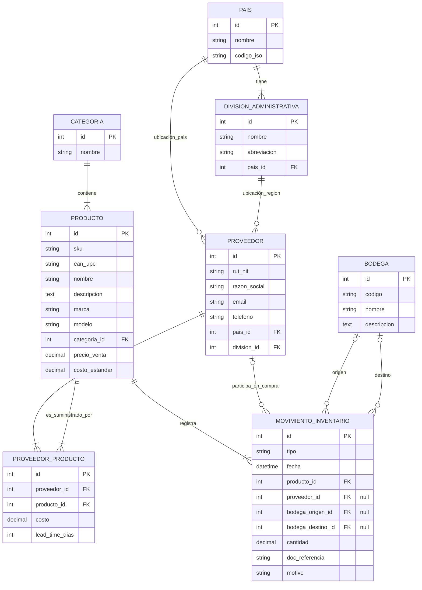

# Base de Datos del ERP Nstock Importaciones

## 1. La tabla `django_migrations`

Esta es una tabla especial que Django crea automáticamente en cualquier base de datos que maneja. Sirve como el "historial" interno de Django. 

Cuando tú ejecutas `python manage.py migrate`, Django revisa esta tabla para ver qué migraciones ya fueron aplicadas. Si encuentra una migración que está en tus archivos (por ejemplo `0001_initial.py`) pero que **no** está en la tabla `django_migrations`, sabe que debe ejecutar las instrucciones SQL para crear esas tablas.

En tu caso particular con el sistema multi-base de datos, aunque el "router" indica que `AppWeb` no se debe crear en MySQL, Django guarda un registro en `django_migrations` para recordar que ya evaluó esa app y decidió saltarla. De esa forma no vuelve a intentar evaluarla la próxima vez. Es una tabla de control y nunca debes modificarla manualmente.

---

## 2. Diagrama Entidad-Relación (ERD)

A continuación tienes el diagrama de cómo quedaron construidas y relacionadas las tablas del ERP en tu base de datos MySQL (`NstockImportacionesBDD`):

### Relaciones Clave:
1. **Catálogo:** Un `Producto` pertenece a una `Categoria`.
2. **Proveedores y Localización:** Un `Proveedor` está ubicado en un `Pais` y opcionalmente en una `DivisionAdministrativa` (como región o estado).
3. **Catálogo + Proveedores:** La tabla intermedia `ProveedorProducto` permite definir a qué precio te vende un mismo `Producto` un `Proveedor` específico y cuánto tarda en llegar (*lead time*).
4. **Inventario:** Los `MovimientoInventario` conectan casi todo el sistema. Relacionan qué `Producto` se movió, desde/hacia qué `Bodega`, la cantidad, y en caso de una entrada por compras, de qué `Proveedor` provino.
